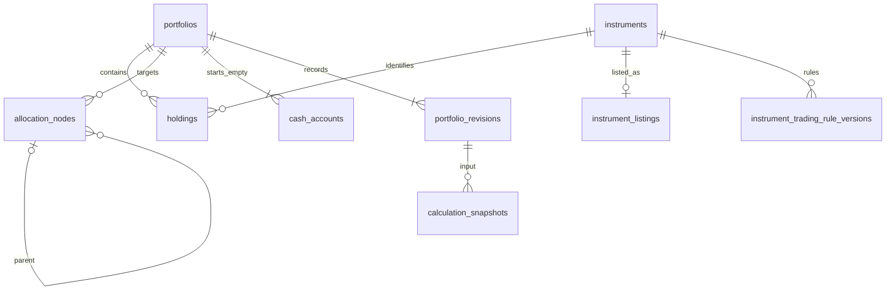

# Planejamento do banco de dados do Investment Factory

**Responsável:** Sol. **Data:** 2026-11-08. **Estado:** desenho técnico para implementação por cards; nenhuma migration ou alteração de banco foi executada nesta etapa.
**Base:** PostgreSQL 17, já previsto no [Compose](../compose.yaml), SQLAlchemy e Alembic no backend. A Factory mantém contratos e planejamento; o banco de carteira pertence ao produto backend, separado do futuro SQLite da orquestração.

## Regras que o banco precisa preservar

A carteira começa sem posições e com caixa conhecido zero. O usuário cadastra o que possui e informa um novo orçamento de aporte. Uma simulação não cria depósito, compra ou posição. Valores originais conservam valor decimal e moeda; conversões aparecem apenas em relatórios/snapshots.

Ações usam quantidades inteiras positivas. Produtos que permitem fracionamento podem usar frações conforme regras verificadas do produto. CDB é um exemplo de produto fracionável; seu principal é um valor monetário, não uma ação com preço fictício igual a um. ETFs e outros produtos não recebem permissão de fração apenas porque o campo aceita decimal. Mínimos, incrementos e unidade precisam ser conhecidos para a recomendação.

O desenho acomoda CDB em uma extensão de produto; a cobertura inicial aprovada continua sendo ações/ETFs dos EUA. Ativar outro produto exige seu contrato, dados e card, sem alterar a regra de fracionamento já decidida.

## Núcleo relacional e histórico

O estado atual fica em tabelas relacionais; cada alteração da carteira grava uma revisão imutável na mesma transação. O snapshot de cálculo referencia uma revisão e os dados de mercado realmente usados. Histórico não é reconstruído usando a cotação atual nem dados sobrescritos.

### Tabelas centrais — primeira entrega C01

| Tabela | Colunas essenciais | Chaves e invariantes |
|---|---|---|
| `currencies` | `code text`, descrição, disponibilidade | PK code; formato ISO de três letras. Cadastro de moeda suportada é técnico; não armazena taxa cambial. USD precisa existir antes da carteira padrão. |
| `portfolios` | `id uuid`, `name text`, `reporting_currency_code`, `revision bigint`, `created_at/updated_at timestamptz` | PK id; moeda FK; revision >=1. Preferência de consolidação não atualiza moedas de posições/caixa. |
| `instruments` | `id uuid`, `kind`, `native_currency_code`, `metadata_status`, timestamps | PK estável; tipo e moeda validados. Identidade informada não equivale a cotação verificada. |
| `instrument_listings` | `instrument_id`, `exchange_mic`, `ticker_normalized` | PK/FK instrument_id e UNIQUE exchange/ticker. A API atual stock/ETF faz join com a listagem; registro idempotente devolve a mesma identidade. |
| `holdings` | `id uuid`, `portfolio_id`, `instrument_id`, `quantity_text`/valor numeric, `original_cost_text`/valor numeric e moeda nullable, `as_of_date date` nullable, timestamps | PK id; UNIQUE portfolio/instrument; quantidade positiva; ação com valor inteiro. Custo/moeda ambos nulos ou ambos presentes. Inventário não gera movimentação de caixa. |
| `allocation_nodes` | id, portfolio_id, parent_id nullable, kind, label, relative_weight_text/valor numeric, instrument_id nullable | PK id; UNIQUE portfolio/id não diferível; FK composta de pai no mesmo portfolio. Regras de árvore descritas abaixo. |
| `cash_accounts` | `id uuid`, `portfolio_id`, `currency_code`, timestamps | PK id; UNIQUE portfolio/moeda. A criação abre a conta da moeda inicial sem movimentos; saldo conhecido zero. Não há saldo mutável duplicado em portfolios. |
| `portfolio_revisions` | portfolio_id, revision, snapshot_schema_version, `state_jsonb`, recorded_at | PK composta portfolio/revision; imutável. Congela valores originais, posições, metas e configuração daquela revisão. Strings decimais permanecem strings no JSONB. |

No MVP, cada instrumento listado representa uma identidade de negociação normalizada, com uma listagem e sua moeda. Não colapsar venues/moedas diferentes em um único ID: isso tornaria a origem do preço e a unicidade das posições ambíguas. Tipos stock/ETF exigem a listagem criada na mesma transação. A relação opcional prepara tipos futuros sem listagem de bolsa.

Identificação de renda fixa não será forçada a ter ticker/MIC falsos. Uma futura tabela `deposit_products` referencia o instrumento e registra emissor, vencimento e termos estruturados, quando o produto for aprovado. Tipos de instrumento devem ser extensíveis por migration de catálogo, sem um enum que obrigue transformar CDB em stock.

`holding_count` e `targets_configured` são derivados do estado consistente, sem colunas redundantes que possam divergir. Não há DELETE de carteira no contrato C01. Histórico/revisões e snapshots referenciados usam restrição de exclusão; não se apagam planos por cascata ao corrigir uma posição.

## Decimais, moedas e datas

Para entradas monetárias, guardar a representação aceita em `*_text` e uma representação exata `numeric` para comparação/cálculo. A API lê o campo textual para devolver o original; nunca o reconstrói a partir de float ou de uma conversão. O custo original pode estar em moeda diferente da moeda do instrumento.

O texto segue o contrato: no máximo 128 caracteres, sem expoente, separador de milhar, NaN ou infinito. Não adotar `numeric(18,2)` para todas as entradas: uma escala fixa poderia arredondar valores válidos. Usar numeric sem escala fixa, limitado pela validação textual do domínio. Valores calculados seguem uma política de arredondamento explícita e versionada, separada do original.

A proposta usa colunas numeric `GENERATED ALWAYS ... STORED` derivadas diretamente do próprio texto da linha, quando a expressão for aceita como imutável pelo PostgreSQL 17. A migration deverá provar essa condição. Uma coluna gerada não pode depender de outra coluna gerada; totais usam os textos originais ou cálculo transacional explícito. Não esconder consultas a outras tabelas dentro dessas expressões.

SQLAlchemy deve usar Decimal/`Numeric(asdecimal=True)` com driver que preserve Decimal. A serialização original usa o texto, e testes de integração devem detectar qualquer coerção para float ou escala reduzida.

`as_of_date` informado pelo usuário é DATE; não inventar horário de aquisição. Timestamps de criação/coleta/cálculo usam TIMESTAMPTZ e UTC na API. Ausência de custo ou cotação permanece NULL com estado de qualidade; somente o saldo do histórico vazio conhecido é zero.

## Quantidade e granularidade por produto

`instrument_trading_rule_versions` terá PK id, UNIQUE instrument_id/version, order_basis, quantity_unit, `product_fractional_allowed boolean NULL`, minimum_quantity, quantity_step, step_origin e, para produtos por valor, minimum_amount/amount_step com moeda. A capacidade do produto é separada da restrição do proprietário: ações continuam inteiras mesmo que uma fonte permita frações; para outros tipos, NULL é desconhecido e não significa autorização. Guardar fonte, data de validade/coleta e versão da regra de negócio aplicada. Valores mínimos e incrementos são decimais exatos; NULL significa regra não conhecida, não um mínimo inventado.

- Ação: quantidade positiva e `quantity = trunc(quantity)`. Formato como “2.000” representa duas unidades inteiras; “2.5” é inválido. A restrição vale para cadastro e recomendação.
- Produto fracionável: recomendação respeita capacidade verificada, mínimo e grade de incremento. A grade precisa indicar sua origem; não presumir que todo mínimo seja um múltiplo do incremento.
- Inventário existente não precisa satisfazer o mínimo atual de uma nova ordem. Ele continua sujeito à positividade/unidade e à regra de ações inteiras. Mínimos e incrementos de execução se aplicam à nova recomendação.
- CDB futuro: ordem baseada em principal monetário, com moeda/mínimo/incremento reais. Não registrar “frações de ação” ou cotação unitária fictícia para adaptar o produto ao schema de bolsa.
- Informação necessária de granularidade ausente bloqueia o cálculo com motivo explícito. O tipo genérico decimal no contrato não autoriza compra fracionada.

A regra que consulta o tipo de instrumento precisa de serviço transacional e trigger adequada; CHECK não deve consultar outra tabela. Mudança de classificação do instrumento também precisa proteger posições existentes: não transformar silenciosamente um produto fracionável em ação nem normalizar sua quantidade; tratar conflito de metadados com correção explícita. Regras e metadados usados em planos salvos permanecem recuperáveis, inclusive após atualização da política vigente.

## Árvore de alocação e concorrência

O pai de um nó é opcional; NULL significa filho da raiz implícita. Usar FK `(portfolio_id,parent_id) → (portfolio_id,id)` com MATCH SIMPLE, diferível, apoiada por chave UNIQUE não diferível. MATCH FULL impediria a raiz com portfolio preenchido e parent nulo. Indexar as colunas de referência.

CHECKs locais validam peso entre 0 e 100, formato/positividade aplicável e vínculo instrumento/tipo do nó. Um nó investment exige instrumento e não tem filhos; outros tipos não recebem instrument_id. Folhas são válidas; níveis intermediários podem ser omitidos.

Somatórios, ciclos e relações entre linhas exigem validação de domínio e constraint triggers `AFTER ROW DEFERRABLE INITIALLY DEFERRED`. A função consulta o estado final da transação: cada conjunto não vazio de irmãos soma exatamente 100, inclusive filhos da raiz; a árvore inteira vazia é válida. Validar pai antigo e novo no reparenting, órfãos, ordem crescente de níveis e ciclos em todos os nós, inclusive componentes sem raiz. Não confiar apenas em percorrer a partir das raízes.

Protocolo de escrita em READ COMMITTED:

1. Abrir transação e bloquear a linha de portfolios com FOR UPDATE antes de ler/modificar filhos.
2. Depois de obter o lock, conferir a revisão esperada de If-Match contra a revisão atual. Pedido ausente resulta em 428; revisão vencida, 412.
3. Validar e aplicar a alteração; permitir desequilíbrios intermediários durante a substituição completa de metas.
4. Validar o estado final, incrementar a revisão uma vez, atualizar o timestamp e inserir portfolio_revisions.
5. Commit dispara as verificações diferidas; qualquer erro reverte estado atual e histórico juntos.

Todo caminho de escrita precisa serializar pelo mesmo portfolio; bloquear apenas nós/posições não resolve inserções concorrentes. Uma função/trigger de guarda deve proteger caminhos autorizados de escrita direta sem alterar a revisão uma vez por nó. Para múltiplas carteiras, ordenar locks de forma determinística.

A função diferida não presume que OLD/NEW ainda existam. Nunca pular a validação apenas porque um nó foi removido. Caso uma futura operação de exclusão de carteira seja aprovada, tratar explicitamente a ausência do portfolio e sua política de histórico; C01 não autoriza esse purge.

Leituras que retornam ETag e múltiplas coleções precisam de um snapshot consistente: uma única consulta ou transação somente leitura REPEATABLE READ. Não reutilizar esse isolamento como se leituras antigas de uma escrita fossem automaticamente atualizadas após esperar por lock. Conflitos/serialização/deadlocks recebem tratamento e retry limitado, sem repetir silenciosamente POST mutável.

## Mercado, cálculos e planejamento — entregas posteriores

| Tabela | Dados e relacionamento | Limite |
|---|---|---|
| `market_sources` / `instrument_provider_ids` | Fonte, identidade normalizada e IDs externos | Credenciais ficam fora do banco/repositório; resposta bruta de provider não é contrato de domínio. |
| `price_observations` | Instrumento, preço original/moeda/unidade, source_id, as_of, collected_at, observation_status | Valor positivo quando observado; NULL para ausência. Fresh/stale é avaliado por política/data da consulta, não um booleano eterno na linha. |
| `fx_observations` | Par, direção quote-per-base, taxa textual/numeric, fonte e datas | Sem taxa fictícia para preencher lacuna; conversão de mesma moeda é identidade explícita, não uma cotação externa inventada. |
| `policy_versions` | Tipo, versão, definição validada e vigência de regras de cálculo | Não define scorecards/fees por conta própria; preserva a configuração efetivamente aprovada. |
| `calculation_snapshots` | UUID, portfolio/revision FK, algoritmo/políticas, input/output JSONB versionados | Congela entradas reais e originais quando um resultado é salvo explicitamente; não usa a carteira atual para reconstituir o passado. |
| `snapshot_price_inputs` / `snapshot_fx_inputs` | Junções para observações imutáveis usadas | Um mesmo portfolio/revision pode ter vários cálculos em datas de mercado diferentes. |
| `contribution_plans` / `contribution_plan_items` | Orçamento original, alocado, restante, ativo, quantidade ou principal e custos separados | Soma exata de alocado + restante = orçamento na mesma moeda; soma dos itens igual ao alocado; plano não é compra. |
| `purchases` | Compra informada, quantidade/principal, preço e moeda originais, data, taxas conhecidas/nulas e vínculo opcional a plano | Futuro fluxo explícito de realizado; não inferir execução a partir de recomendação/cotação. |
| `cash_movements` | Conta/moeda, valor original, direção, origem e correção/reversão quando definida | Apenas ação real explícita. Não debitar caixa ao cadastrar inventário ou simular. |

Uma prévia pode produzir um snapshot de resposta em memória sem criar plano persistido. Ao salvar explicitamente, congelar também as regras por instrumento e entradas de mercado usadas; nunca recalcular o plano salvo com dados atuais. Cache/observações de mercado podem ser persistidos pelo backend conforme a política de dados, sem alterar a posição ou o caixa.

Na fase que introduzir cash_movements, o saldo é derivado dos movimentos da conta em sua moeda original, com zero para a conta conhecida sem movimentos. Não converter e sobrescrever esse saldo por mudança da moeda de relatório. Antes dessa fase, o contrato só expõe o saldo inicial conhecido; não há endpoint de mutação de caixa em C01.

Política de saldo negativo, impostos, dividendos, taxas e movimentações ainda será definida nas features correspondentes. O desenho deixa esses casos explícitos sem inventar lançamentos ou regras de rentabilidade.

## Índices e exclusões

Criar apenas índices justificados: UNIQUE listagem exchange/ticker; UNIQUE holding portfolio/instrument; índices FK portfolio/parent e instrumento; PK portfolio/revision; índices de observação por instrumento/par + fonte + as_of descendente; planos/purchases por portfolio/data. Não criar GIN genérico em todo JSONB sem consulta real.

Dados correntes de uma posição podem ser corrigidos/removidos; revisões e planos preservam seus originais. Não usar CASCADE que destrua snapshots históricos. Append-only exige privilégios de runtime e/ou triggers contra UPDATE/DELETE; JSONB sozinho não garante imutabilidade. Backup precisa incluir schema, histórico, observações referenciadas e versões das políticas.

## Sequência planejada de migrations

| Etapa lógica | Conteúdo | Gate |
|---|---|---|
| M1 — núcleo C01 | Moedas, portfolios, instrumentos/listagens, holdings e contas de caixa vazias | Preservação do scaffold, contrato C01 e testes do original/quantidade inteira. |
| M2 — metas e histórico C01 | Allocation nodes, chaves compostas, guards/triggers diferidos, revisões imutáveis | Transações, grafos, concorrência e rollback em PostgreSQL 17 real. |
| M3 — mercado e regras | Fontes/IDs, observações de preço/FX e regras de negociação versionadas | Contratos C02, cobertura/termos/fontes e granularidade verificada. |
| M4 — planos | Políticas, snapshots e planos/itens com conservação do orçamento | C03/feature 004 e regras financeiras aprovadas. |
| M5 — realizado e caixa | Compras, reconciliação e movimentos explícitos | Contrato de realizado e decisões de caixa/taxas correspondentes. |
| M6 — renda fixa/novos produtos | Identidade de depósito e ordem por principal quando aprovadas | Cobertura, termos e contrato específico do produto, sem MIC/cotação fictícios. |

M1–M6 são nomes de planejamento, não revisões Alembic já criadas. As migrations reais entram no backend em branch/worktree por card e PR para develop, com revisão do proprietário. O implementador verifica a versão de SQLAlchemy/Alembic fixada no manifesto antes de gerar código.

Autogenerate gera candidatos, que precisam de revisão. Triggers, funções, privilégios e mudanças semânticas de constraints exigem inspeção explícita. A detecção de CHECK depende da versão/opções do Alembic e não prova que uma expressão foi atualizada. Testar upgrade e downgrade/re-upgrade somente em banco descartável; nenhuma reversão de dados do proprietário é parte desta etapa de planejamento.

## Provas exigidas antes do PR backend

- Round-trip de “1234.5600” em BRL, custo NULL distinto de zero e mudança de consolidação sem reescrever originais.
- Rejeitar expoente/NaN/infinitos/valores fora do limite; nenhuma conversão float ou arredondamento de entrada.
- Ação “2”/“2.000” válida e “2.5” inválida; produto fracionável com regras conhecidas aceita a grade correta e rejeita mínimos/incrementos inválidos.
- Árvore vazia e folhas válidas; filhos da raiz e de cada pai somam exatamente 100; testar camada omitida, órfão, pai de outra carteira, ciclo desconectado e reparenting.
- Substituição temporariamente desequilibrada pode terminar válida; commit inválido deixa estado e revisão anteriores intactos.
- Duas conexões reais testam bloqueio do portfolio, 412 após espera, ausência de update perdido e uma revisão por operação.
- Snapshot/revisão não pode ser mutado pelo runtime; correção da posição atual preserva o histórico.
- Criar carteira e simular aporte preservam caixa zero; somente fluxo real explícito poderá criar movimento na etapa correspondente.
- Inspecionar constraints, FKs, funções e timing dos triggers após upgrade; schema com SQLite/mock não substitui esses testes PostgreSQL.
- Exportar OpenAPI do subconjunto implementado e comparar com o contrato; nenhum endpoint financeiro fake para tornar a CI verde.

## Fontes técnicas verificadas

[Numeric PostgreSQL 17](https://www.postgresql.org/docs/17/datatype-numeric.html), [colunas geradas](https://www.postgresql.org/docs/17/ddl-generated-columns.html), [constraints](https://www.postgresql.org/docs/17/ddl-constraints.html), [constraint triggers](https://www.postgresql.org/docs/17/sql-createtrigger.html), [CTEs/ciclos](https://www.postgresql.org/docs/17/queries-with.html), [locks](https://www.postgresql.org/docs/17/explicit-locking.html), [isolamento](https://www.postgresql.org/docs/17/transaction-iso.html), [JSONB](https://www.postgresql.org/docs/17/datatype-json.html) e [Alembic autogenerate](https://alembic.sqlalchemy.org/en/latest/autogenerate.html). O protocolo de domínio e a divisão em fases acima são decisões de desenho do projeto, não funcionalidades já implementadas.
